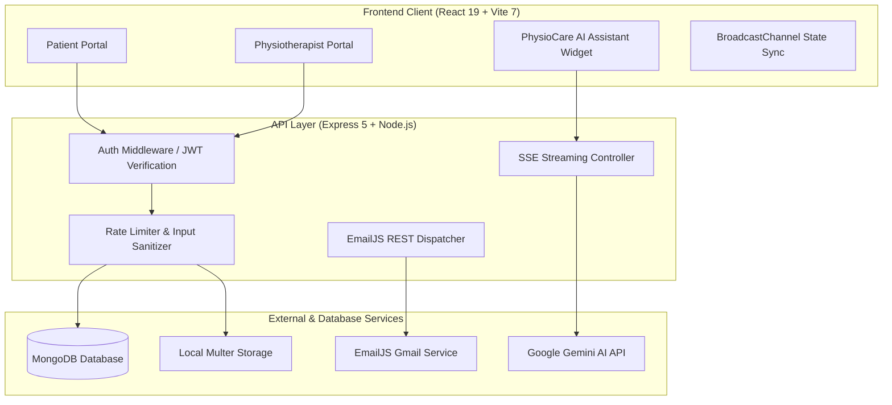

# 🏥 PhysioCare — Clinical Tele-Rehabilitation & Physiotherapy Management System

<p align="center">
  
</p>

<h3 align="center">Next-Generation Tele-Physiotherapy & Recovery Platform</h3>

<p align="center">
  A modern full-stack MERN healthtech platform connecting patients with certified physiotherapists for remote consultations, personalized rehabilitation programs, exercise video libraries, clinical PDF session reports, and an AI-powered physiotherapy recovery assistant.
</p>

<p align="center">
  <a href="https://github.com/rishavrjpt/PhysioCare"></a>
  
  
  
  
  
  
  
</p>

---

## 🌟 Executive Overview

**PhysioCare** bridges the gap between clinical rehabilitation and home recovery. Designed with a calm recovery teal/cyan palette and accessibility-first clinical UX, the platform provides dual specialized portals:

1. **For Patients**: Discover verified physiotherapists by city, book home/clinic visits, enroll in specialized rehabilitation regimens, watch prescribed exercise video tutorials, log pain metrics, download professional A4 medical session reports, and consult **PhysioCare AI** for instant physiotherapy recovery tips.
2. **For Physiotherapists (Doctors)**: Manage patient pipelines, issue comprehensive clinical session reports with prescriptions & digital stamps, create multi-week rehabilitation regimens with unique shareable access codes, publish patient educational articles, and monitor recovery progress.

---

## 🚀 Key Highlights & Architectural Strengths

- **🤖 PhysioCare AI Recovery Assistant**: Real-time Server-Sent Events (SSE) streaming chatbot powered by Google Gemini (`gemini-flash-lite-latest` & `gemini-3.1-flash-lite`). Configured with emergency triage safety guardrails and strict domain-scoping exclusively to physiotherapy, exercise mechanics, ergonomics, and mobility.
- **📄 Clinical A4 Session Reports**: Auto-generated clinical letterheads with clinic verification stamps, physician signature lines, clinical Rx boxes, and print-optimized CSS for PDF export.
- **🔐 Secure Authentication Pipeline**: Email OTP verification with 60-second cooldown via EmailJS REST API, JWT-based role isolation (`patient`, `doctor`, `admin`), bcrypt password hashing, and optional Google OAuth 2.0.
- **⚡ High-Performance Architecture**: MongoDB compound indexing, `.lean()` query projections, gzip compression with SSE bypass, and in-memory multi-tab synchronized state (`BroadcastChannel`).
- **📱 Responsive & Resilient**: Built with Tailwind CSS, custom Calm Recovery design tokens, and optimistic UI updates with automatic rollbacks on network interruptions.

---

## 🏗️ System Architecture



---

## 🎯 Dual-Portal Feature Matrix

### 👤 Patient Experience
- **Smart Onboarding**: Capture comprehensive injury profiles, medical history, emergency contacts, and rehabilitation goals.
- **Geographic Doctor Discovery**: Filter certified specialists by city, experience, clinical ratings, consultation fees, and hospital affiliations.
- **Appointment Lifecycle**: Instant booking with automated conflict checking, status tracking (`pending`, `confirmed`, `completed`, `cancelled`), and post-session clinical reviews.
- **Regimen Code Enrollment**: Join doctor-curated rehabilitation programs using 6-character access codes.
- **Video Therapy & Pain Tracker**: Stream targeted rehabilitation video routines and log subjective pain scores (1–10) per session.
- **Report Vault**: View and download printable clinical records containing prescriptions, physician notes, and scheduled follow-ups.

### 🩺 Physiotherapist Experience
- **Clinical Practice Management**: Real-time patient queues, calendar views, and availability toggle.
- **Clinical Session Report Authoring**: Formulate structured clinical notes, medicines/lifestyle suggestions, exercise plans, and next follow-up dates.
- **Rehabilitation Program Studio**: Create multi-exercise treatment tracks with auto-generated secure patient enrollment codes.
- **Exercise Media Library**: Upload high-resolution exercise demonstration videos (MP4/WebM/MOV) or embed external clinical references.
- **Health Article Publishing**: Draft and publish clinical educational articles with category tagging and cover image uploads.
- **Confidential Patient Case Notes**: Maintain private doctor-only clinical observation logs per patient.

---

## 🛠️ Technology Stack

| Layer | Technologies |
|---|---|
| **Frontend UI** | React 19, Vite 7, React Router 7, Tailwind CSS 4, Lucide / React Icons |
| **Backend API** | Node.js (v18+), Express 5, Multer, Compression, Express Rate Limit |
| **Database & ODM** | MongoDB (v6+), Mongoose 9 (Optimized with Compound Indexes & Lean Queries) |
| **AI / LLM Integration** | Google Gemini (`gemini-flash-lite-latest`, `gemini-3.1-flash-lite`) via REST SSE |
| **Notification Engine** | EmailJS REST API (Direct server-side dispatch with private access token) |
| **Security & Auth** | JSON Web Tokens (JWT), bcryptjs, Secure HttpOnly headers, CORS whitelisting |

---

## 📂 Project Directory Layout

```text
PhysioCare/
├── backend/
│   ├── config/
│   │   ├── db.js                 # Resilient MongoDB pool + auto-fallback
│   │   ├── emailService.js       # EmailJS REST API dispatch
│   │   ├── googleAuthConfig.js   # Passport Google OAuth strategy
│   │   └── paths.js              # Media upload path resolvers
│   ├── controllers/              # REST & SSE stream business logic
│   ├── middleware/
│   │   └── authMiddleware.js     # JWT guard, role-based access & validation
│   ├── models/                   # Mongoose schemas (User, Appointment, Report, etc.)
│   ├── routes/                   # Modular Express routers
│   ├── uploads/                  # Uploaded patient media & article covers
│   ├── .env.example              # Sample environment template
│   └── server.js                 # Server entrypoint with SSE compression bypass
├── frontend/
│   ├── src/
│   │   ├── components/           # Global ChatAssistant, layouts, headers, modals
│   │   ├── pages/                # Patient pages & doctor portal (/pages/doctor/*)
│   │   ├── style/                # Scoped CSS stylesheets & Calm Recovery tokens
│   │   ├── utils/                # Data stores, image compressors, auth handlers
│   │   ├── config.js             # API base URL configuration
│   │   └── App.jsx               # Universal application router & global widgets
│   ├── index.html                # Single-page application root
│   ├── vite.config.js            # Vite build configuration
│   └── vercel.json               # SPA routing rewrite rules for Vercel
├── package.json                  # Root monorepo runner (concurrently)
└── README.md                     # Documentation
```

---

## ⚡ Quickstart Guide (Local Development)

### Prerequisites
- **Node.js**: v18.0.0 or higher
- **npm**: v9.0.0 or higher
- **MongoDB**: Active local instance (`mongodb://127.0.0.1:27017/physiocare`) or a MongoDB Atlas cluster URI.

### 1. Clone & Install Dependencies
```bash
git clone https://github.com/rishavrjpt/PhysioCare.git
cd PhysioCare

# Install root, backend, and frontend dependencies in one command
npm run install:all
```

### 2. Configure Environment Variables

**Backend (`backend/.env`):**
```bash
cp backend/.env.example backend/.env
```
Fill in the following values:
```env
PORT=8080
MONGO_URI=mongodb://127.0.0.1:27017/physiocare
JWT_SECRET=your_super_secret_jwt_key_here
FRONTEND_URL=http://localhost:5173

# EmailJS OTP Setup (Optional for dev — prints OTP to terminal if empty)
EMAILJS_SERVICE_ID=your_service_id
EMAILJS_TEMPLATE_ID=your_template_id
EMAILJS_PUBLIC_KEY=your_public_key
EMAILJS_PRIVATE_KEY=your_private_key

# PhysioCare AI (Google Gemini)
GEMINI_API_KEY=your_gemini_api_key
CHAT_MODEL=gemini-flash-lite-latest
```

**Frontend (`frontend/.env`):**
```bash
cp frontend/.env.example frontend/.env
```
```env
VITE_API_BASE_URL=http://localhost:8080/api
```

### 3. Launch Development Environment
```bash
npm run dev
```

Both services will boot concurrently:
- 🌐 **Frontend Client**: [http://localhost:5173](http://localhost:5173)
- ⚙️ **Backend REST API**: [http://localhost:8080](http://localhost:8080)
- 🩺 **Health Check**: [http://localhost:8080/api/health](http://localhost:8080/api/health)

---

## 📡 REST API Architecture

All protected endpoints require an `Authorization: Bearer <token>` header.

### Authentication & Profiles (`/api/auth`)
| Method | Endpoint | Access | Purpose |
|---|---|---|---|
| `POST` | `/api/auth/signup` | Public | Register patient or physiotherapist |
| `POST` | `/api/auth/verify-otp` | Public | Verify 6-digit OTP code & receive JWT |
| `POST` | `/api/auth/resend-otp` | Public | Resend verification OTP (60s cooldown) |
| `POST` | `/api/auth/login` | Public | Role-verified portal login |
| `POST` | `/api/auth/forgot-password` | Public | Send password reset OTP |
| `POST` | `/api/auth/reset-password` | Public | Set new password with OTP token |
| `GET` | `/api/auth/:id` | Authenticated | Retrieve user profile & medical history |
| `PATCH` | `/api/auth/:id/complete-profile` | Authenticated | Finalize clinical onboarding questionnaire |

### Clinical Appointments (`/api/appointments`)
| Method | Endpoint | Access | Purpose |
|---|---|---|---|
| `POST` | `/api/appointments` | Patient | Book consultation (checks conflict & availability) |
| `GET` | `/api/appointments/doctor/:id` | Doctor | Fetch doctor appointment roster |
| `GET` | `/api/appointments/patient/:id` | Patient | Fetch patient booking history |
| `PATCH` | `/api/appointments/:id/status` | Doctor / Patient | Modify status (`confirmed`, `cancelled`, etc.) |
| `POST` | `/api/appointments/:id/complete` | Doctor | Submit clinical examination report & Rx |
| `POST` | `/api/appointments/:id/review` | Patient | Submit rating & post-session recovery feedback |
| `PATCH` | `/api/appointments/:id/send-to-patient` | Doctor | Publish finalized report to patient vault |

### AI Physiotherapy Assistant (`/api/chat`)
| Method | Endpoint | Access | Purpose |
|---|---|---|---|
| `GET` | `/api/chat/status` | Public | Verify active status and provider readiness |
| `POST` | `/api/chat/stream` | Public / Auth | SSE real-time streaming physiotherapy recommendations |

---

## 🔒 Security & Medical Compliance Principles

1. **Medical Advisory Notice**: PhysioCare AI strictly provides general rehabilitation guidance, ergonomic tips, and exercise cues. It is hardcoded to never diagnose clinical pathology or prescribe pharmaceutical regimens. Emergency symptom keywords automatically trigger emergency hospital dispatch recommendations.
2. **Data Minimization & Ownership**: Medical reports, private physician notes, and recovery logs are guarded by authorization middleware verifying relational ownership between patient and consulting doctor.
3. **Transport Security**: Production deployments mandate TLS termination, CORS origin lock, rate-limiting on authentication vectors, and sanitized input validation.

---

## 🚀 Production Deployment

### Backend on Render
1. Connect this repository to a **Render Web Service**.
2. Set **Root Directory** to `backend`.
3. Set **Build Command** to `npm install` and **Start Command** to `node server.js`.
4. Supply environment variables from `backend/.env` with `NODE_ENV=production`.

### Frontend on Vercel
1. Import the repository into **Vercel**.
2. Set **Root Directory** to `frontend`.
3. Set **Framework Preset** to `Vite`.
4. Add environment variable: `VITE_API_BASE_URL=https://<your-backend-domain>/api`.
5. Deploy.

---

## 👨‍💻 Project Maintainer

<p align="left">
  <strong>Rishav Raj</strong><br/>
  GitHub: <a href="https://github.com/rishavrjpt">@rishavrjpt</a><br/>
  Email: <a href="mailto:rajrishav7013@gmail.com">rajrishav7013@gmail.com</a>
</p>

---

## 📜 License

This project is licensed under the **MIT License** — see the [LICENSE](LICENSE) file for details.
All rights reserved © 2026 PhysioCare.
